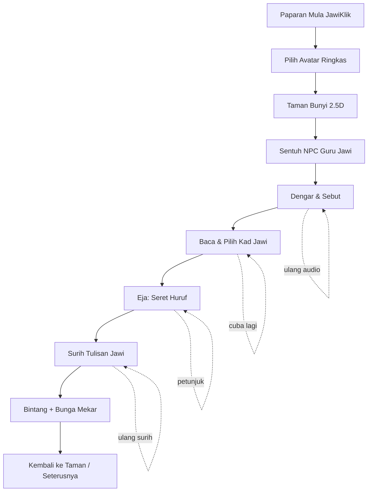

# JawiKlik — GAME FLOW v0.1 (Dokumen v2)

**Matlamat:** Satu perjalanan pendek dan lengkap untuk murid, menggunakan telefon **menegak**.  
**Lokasi:** Taman Bunyi sahaja.  
**Empat kemahiran:** Dengar/Sebut → Baca → Eja → Surih/Tulis.
**Animasi asas:** avatar idle/walk dan NPC Guru idle/talk daripada sprite sheet PNG, apabila aset disahkan.

---

## 1. Aliran skrin



## 2. Paparan utama (portrait)

```text
┌──────────────────────────────┐
│ ⚙              ★ 0    🔊    │ ← status minimum
├──────────────────────────────┤
│                              │
│      TAMAN 2.5D CERIA        │
│     🌳   🧒   🌼   🏡         │
│        NPC GURU JAWI         │
│                              │
│    Tap laluan / objek        │
│                              │
├──────────────────────────────┤
│    Panel misi kontekstual    │
│    [Kad / audio / seret]     │
│    [Butang ulang bunyi]      │
├──────────────────────────────┤
│       Selamat untuk ibu jari │ ← safe area
└──────────────────────────────┘
```

**Nota:** Lakaran menunjukkan fungsi, bukan arahan membuat emoji sebagai grafik akhir. Pada aktiviti **menulis**, papan surih mengambil ruang yang lebih luas dan dunia 2.5D boleh dikecilkan sementara.

## 3. Butiran perjalanan

| Langkah | Yang murid nampak | Interaksi | Output / maklum balas |
|---|---|---|---|
| **01 Mula** | Logo JawiKlik, taman berwarna, “Mula” besar | Tap **Mula** | Audio aktif selepas tap pertama |
| **02 Avatar** | 2–3 rupa avatar mesra murid | Tap satu avatar | Avatar dipilih; tiada butang simpan akaun |
| **03 Teroka** | Taman mini dengan NPC bertanda gelembung | Tap lokasi pada laluan pendek atau NPC | Avatar memainkan `walk_side` (dicermin jika bergerak ke kanan), kemudian `idle` apabila berhenti; dialog pendek keluar |
| **04 Dengar** | Ikon speaker besar + contoh suku kata | Tap speaker, ulang, sebut dengan suara sendiri | NPC memainkan `talk` ketika audio/dialog aktif; murid tap **Saya sudah sebut**, tidak auto-nilai sebutan |
| **05 Baca** | 3 kad Jawi bersaiz besar | Tap kad sepadan dengan bunyi | Betul: kad bercahaya. Salah: dengar semula + petunjuk |
| **06 Eja** | Huruf Jawi boleh diseret dan slot kosong | Seret huruf mengikut susunan kanan-ke-kiri | Jawi dicantum dengan betul pada paparan jawapan |
| **07 Surih** | Model huruf bersambung dengan panduan titik/laluan | Jari menyurih pada papan | Jalur surihan dikira selesai jika mencukupi; reset tersedia |
| **08 Ganjaran** | Bunga mekar, bintang dan dialog NPC | Tap **Teruskan** | Taman berubah sedikit dan kemajuan bertambah |

## 4. Spesifikasi mini game

### A. Dengar & Sebut

- Butang speaker **besar**, bunyi tidak bermain sebelum pengguna menekan **Mula**.
- Sebutan daripada rakaman guru yang disemak untuk setiap entri.
- Teks “Dengar, kemudian sebut.” — Rumi untuk arahan, Jawi untuk bahan pelajaran.
- Selepas murid menyebut, murid menekan **Saya sudah sebut**. Tanda ini ialah **penanda cubaan**, bukan markah ketepatan suara.
- Pilihan guru: semak lisan secara langsung di kelas, tidak perlu dalam sistem v0.1.

### B. Baca & Pilih

- Model: audio sebutan → 3 kad Jawi → pilih satu.
- Kad tidak bergerak berterusan; animasi apabila disentuh sahaja.
- Pengecoh mesti munasabah tetapi tidak mengelirukan dari segi ejaan/vokal; disemak oleh guru.
- Sentiasa tunjuk butang “Dengar lagi”.

### C. Eja & Susun

- Huruf sebagai cip interaktif; ruang jawapan diatur **RTL**.
- Murid seret huruf Jawi ke slot. Sistem menggunakan **teks Unicode Jawi sebenar** untuk menghasilkan suku kata bersambung pada akhir susunan.
- Arahan ringkas: “Susun huruf menjadi suku kata.”
- Petunjuk pertama menerangkan susunan kanan-ke-kiri; elak menggunakan pembalikan aksara sebagai jalan pintas.
- Paparkan suku kata **utuh** selepas jawapan siap supaya murid boleh membaca bentuk sebenar.

### D. Surih & Tulis

- **v0.1:** surih bentuk Jawi yang dipaparkan; jari melukis atas lapisan kanvas.
- Sediakan undo / padam, contoh model dan butang cuba lagi.
- Kriteria selesai berdasarkan liputan laluan surihan ringkas, **bukan pengecaman tulisan sempurna**.
- **v0.2+:** mod tulis bebas, pilihan menyemak dengan guru atau contoh. Jangan auto-mengaku “betul” untuk tulisan bebas tanpa model semakan yang telah diuji.

## 5. Contoh kandungan untuk prototaip

Nota sumber mengandungi suku kata tertutup vokal A seperti **بس (bas), جم (jam), چت (cat), ݢم (gam)**. Ini **contoh awal**, bukannya keseluruhan bank data. Paparan Jawi sebenar perlu diuji untuk rendering font dan sebutan perlu dirakam/disemak guru.

| `id` | Rumi | Jawi | Kumpulan | Audio dicadangkan |
|---|---|---|---|---|
| `a_bas` | bas | `بس` | A | `audio/voice/a_bas.mp3` |
| `a_jam` | jam | `جم` | A | `audio/voice/a_jam.mp3` |
| `a_cat` | cat | `چت` | A | `audio/voice/a_cat.mp3` |
| `a_gam` | gam | `ݢم` | A | `audio/voice/a_gam.mp3` |

**Keperluan audit kandungan:** sebelum kod soalan dijana secara besar-besaran, semak padanan Rumi–Jawi, fonetik mengikut konteks Melayu, pemisahan suku kata, bentuk sambungan huruf dan kepelbagaian jawapan betul pada setiap vokal. Khususnya, sesetengah ejaan suku kata tertutup tidak memaparkan huruf vokal tersendiri; jangan sekadar transliterasi automatik.

## 6. Maklum balas yang selamat dan positif

| Keadaan | Dialog ringkas | Reaksi dunia |
|---|---|---|
| Pilihan betul | “Bagus! Cuba sebut sekali lagi.” | Bintang kecil, bunga mengangguk |
| Pilihan salah sekali | “Hampir! Dengar bunyi ini lagi.” | Kad kembali lembut, bunyi contoh dimainkan jika murid menekan speaker |
| Salah berulang | “Mari cuba dengan petunjuk.” | Petunjuk bentuk/huruf muncul |
| Menamatkan misi | “Hebat! Taman semakin ceria!” | Bunga mekar, satu bintang diperoleh |

Jangan gunakan bunyi gagal keras, pemasa menekan, leaderboard awam, atau mesej yang memalukan murid.

## 7. Kes ujian penting

1. **iPhone Safari / Android Chrome**, orientasi tegak dan lebar skrin berbeza, termasuk bar alamat pelayar.
2. Paparan apabila peranti dipusing: tunjuk mesej orientasi; data misi tidak hilang.
3. Ketik main audio dua kali / mute / sambung semula aplikasi: tidak berlaku tindihan suara.
4. Seret huruf pada iOS Safari dan Android Chrome: skrin tidak terskrol ketika menyeret.
5. Semak Jawi RTL dengan `بس`, `جم`, `چت`, `ݢم` menggunakan font sebenar.
6. Surihan berfungsi apabila jari terangkat dan diletak semula; reset jelas.
7. Teks arahan pendek, butang saiz besar, kawasan bawah tidak dihalang bar sistem.
8. Ganjaran tidak diberi untuk sekadar menekan butang **Saya sudah sebut** sebagai bukti sebutan tepat; ia dikira cubaan sahaja.

## 8. Peraturan animasi dalam aliran permainan (v2)

| Keadaan | Watak | Animasi | Pemicu |
|---|---|---|---|
| Taman dimuatkan | Avatar | `idle` | Automatik selepas imej lengkap dimuatkan |
| Murid sentuh laluan | Avatar | `walk_side` (flipX untuk arah kanan) | Semasa watak bergerak menuju destinasi |
| Watak sampai | Avatar | `idle` | Apabila pergerakan selesai |
| Murid sentuh Guru Jawi | NPC Guru | `talk` | Semasa arahan/audio dimainkan |
| Audio guru tamat | NPC Guru | `idle` | Kembali kepada keadaan menunggu |
| Bunga mekar/ganjaran | NPC Guru | `idle` (v0.1) | `point` / `happy` hanya fasa seterusnya |

- Pastikan **audio mula selepas sentuhan pengguna**; animasi mulut boleh dimainkan ketika audio tetapi tidak perlu penyelarasan bibir tepat pada v0.1.
- Pergerakan v0.1 dihadkan kepada laluan pendek yang kebanyakannya mendatar (kiri/kanan) supaya sesuai dengan animasi `walk_side`; pergerakan empat arah memerlukan sprite tambahan pada fasa berikutnya.
- Jika sprite sheet belum lengkap/kemas, gunakan PNG watak statik dahulu; jangan bina animasi palsu dengan frame tidak konsisten.
- Paparan Jawi ialah teks berasingan daripada watak/sprite.
- Fail sumber dan fail game mengikut struktur `source-assets/` vs `public/assets/`; rujuk panduan aset.

## 9. Garis sempadan v0.1

**Jangan bina dahulu:** kampung penuh, kedai, mata wang kompleks, profil murid, log masuk, mod kamera 3D bebas, AI semak suara/tulisan, dan sistem admin. Fokus pada satu aliran misi yang lancar dan tepat dari segi Jawi.
